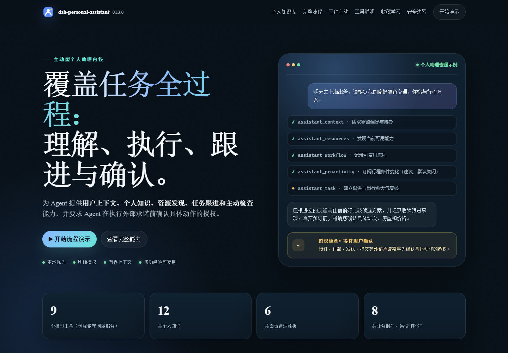

# dsh-personal-assistant 主动型个人助理

| [English](README.md) | [中文](README.zh.md) | [MIT License](LICENSE) |
| :-----------------: | :-----------------: | :-------------------: |

为 [DeepSeek Harness](https://github.com/deepseek-ai/deepseek-harness)（DSH）打造的主动型个人助理内核。

它让 agent 像一位真正的真人助理对待自己敬重的老板那样工作：在意每句话背后的人，分得清什么重要，答应过的事说到做到——包括按自己的排班主动出现。

## 网页演示

[打开交互演示网页](https://mint-hfut.github.io/dsh-personal-assistant/SHOWCASE.zh.html) · [查看单文件网页源码](SHOWCASE.zh.html)

[](https://mint-hfut.github.io/dsh-personal-assistant/SHOWCASE.zh.html)

网页通过交互示例讲解个人知识结构、三种主动性、完整任务流程和收藏学习。页面使用演示数据；真实面板位于 DSH 的「设置 → 个人助理」。也可从发布包解压出 `package/SHOWCASE.zh.html`，直接用浏览器离线打开。

## 它做什么

- **偏好记忆。** 稳定习惯（`travel.seat` 靠窗）+ 情景覆盖（`陪客户用餐：不安排酒`）存在同一个有界库里。缺偏好时一句话问清而不是瞎猜；说法矛盾就更新记录；单次选择不会被擅自泛化，可能对以后有用时会先问您要不要记住。推断出的规律始终是低置信假设，只能辅助排列低成本、可逆的选项，不能当成主人的指令。16 题偏好问卷按需提供一次（答完回读确认，防误触），拒绝过就不再推销。
- **个人知识库。** 有意义的经历、人物与关系、地点与到访、观察与行为模式、当前状态、目标、决策理由、承诺、资料索引、外部规则和假设都可以形成带时间、来源、置信度、敏感级别和关联关系的记录。它与偏好、任务、工作流严格分权：一次选择不会变成偏好，知识里的承诺不会替代需要跟进的任务，任何记录都不构成行动授权。检索按当前问题触发，默认不把整库塞进模型上下文；敏感记录不进入普通清单和 `assistant_context`。设置页把 **12 类【属性】**（对象/关系/产出物/事件/观察/状态/目标/决策/承诺/方法模式/规则/假设）与 **8 类【数据类型】**（教学/攻略/资源库/评测/案例/观点/资讯/工具）分开呈现：属性说明记录在判断中承担什么作用（系统管理、生命周期、检索共用），数据类型说明内容形态（便于手动归类与检索）；对话收藏与外部收藏夹解析出的知识都同时带这两类标签。知识清单默认折叠，可逐行展开或一键全部展开/收起，列表内部滚动、行头吸顶，交互与收藏夹保持一致。
- **主动拆解。** 面对一句模糊需求，助理会先把整件事从头到尾想清楚：找出真正影响结果的决策、依赖、信息缺口与后续跟进；拆解深度随事情本身调整，不把每件事都套进固定模板。
- **三类主动性，可分别开关。** **需求内主动**在用户提出事项后识别依赖、信息缺口、后续动作和关怀事项；**时间驱动主动**从当前对话、已经读取的来源和个人知识中提取未来承诺、预约、截止、行程或复核事项，先与现有任务去重，再创建或更新带来源指针的任务；**外部信息驱动主动**只在用户开启后，允许主动唤醒根据未结任务检查相关只读信号，例如邮件、日历、天气、交通变化、物流、账单、账户通知、健康或设备信号，以及以后接入的新能力。外部信号不会全量轮询，内容也不会被当成指令；没有可行动变化时不打扰用户。
- **提前安排条件复核。** 时间驱动主动开启时，如果未来事项存在适合提前检查的条件，助理会建立单独的复核任务并选择与事件相关的提前量，例如出行前复核天气或交通、付款前检查账单、收货前检查物流、会议前确认材料。只有来源支持具体时间时才写 `due_at`；时间不确定时记录“确认时间”的下一步。
- **跟进到底。** 截止时间、预订、审批、待跟进事项都变成被跟踪的任务——每个被记录的跟进都会连同时间点在回复里说明，您永远知道接下来会发生什么、什么时候发生。费时的活儿中途也会报一声进展，不让您干等。
- **主动检查。** 每个会话一个例程绑定。排班从它服务的跟进事项导出：时刻变了（订了机票、截止日提前）就重绑，让检查赶在那些时刻之前触发；单一时刻则用一次性到点提醒。带截止时间的任务在记录它的会话中自动获得到点唤醒（v0.9.0 起，默认开启）——改期自动跟随，完成、取消或删除即移除。唤醒本身廉价，克制才是产品：被唤醒的助理先看上下文，无事则安静收场。
- **自然关怀。** 舒适、健康、安全、时间缓冲、开支会对照已存偏好来权衡，自然地体现在回复里——不是一张固定清单。
- **资源编排。** 对 agent 当下可见的所有原生工具、经 MCP 挂载的工具与已注册 skill 做有界发现——能力集随会话增减，任务前先探测现在有什么，而不是沿用昨天的环境；回退顺序 tool → skill → 浏览器 → 桌面，发现没跑过绝不宣称做不到。相互独立的子任务会用并行调用或子代理同时推进，缩短您的等待。
- **流程沉淀。** 验证过的成功调用序列可蒸馏成 runtime skill，作为候选路线而不是通用模板。生成的 skill 只接收资源标识和模型提供的非敏感 kebab-case 标签；原始目标、前提、工具参数、结果及其他外部文本不会复制进去。每次复用前仍要根据当前请求重新判断是否适用。
- **对话收藏夹。** 觉得某条回复方式特别好，点回复下方的星标即可收藏：浮窗里 1–5 星表示该轮对话对**个人知识库的重要性**（星级决定解析顺序，也写入知识库优先级），可多选**收藏原因**（指令遵循/表达方式/结果输出/高频场景/过程决策/避坑纠错/偏好线索/灵光一现，最多同时选 2 个）并加备注；收藏后按 star.svg 造型显示，星星五等分顺时针切割，星级点亮 n/5，其余部分抹去颜色（透明）。收藏会记下**整轮对话**：用户提问 + 执行过程概述（该轮**全部助手步骤**的思考，按 step 顺序拼接 + 工具调用序列，只记工具名不记参数，工具名 ≤32 个）+ 助手回复 + 交付文件名；采集按**估算 token** 设限（提问 ≤1024 / 回复 ≤2048 / 过程 ≤16384，均为 1024 的整数倍；备注 ≤800 字），交付文件只记文件名不记内容。设置页默认折叠展示，展开分组即展开组内条目；展开后按「输入 / 过程 / 输出」三段展示（思考以大脑图标聚合成过程链，输出按 Markdown 渲染），每行提供**解析/重试/重新解析**、头部提供**全部解析**。解析把整轮对话喂给 LLM（提示词蒸馏），同时产出**个人知识库**的知识记录与**偏好库**的偏好记录：每个收藏原因在提示词里有独立的主人意图、到知识属性/知识库标签/偏好分类的候选映射、内容骨架与案例，所选原因决定解析重点（过程类原因连同思考与工具调用顺序一起输入，结果类只看问答），知识正文按骨架分段并在界面高亮；情景偏好（`situation`）与外部收藏夹导入共用同一套规则——稳定偏好省略、仅在明确场景下填写、同一 key 可稳定与情景并存。收藏原因与备注会映射为知识标签（中文原因标签 + 数据类型 + 内容标签）；模型必须产出压缩后的摘要而不是原文改写，解析带输出上限的压缩重试与“原文改写”拦截；模型产出 kind/genre/domain/title/content/evidence/tags，宿主按与 `assistant_knowledge` 相同的校验路径入库，星级映射置信度与 `priority`，失败时显示具体原因；解析在后台逐条排队（星级降序），客户端轮询展示「解析中…」；宿主每次启动自动解析待解析项；内容有变化时重新保存会重置为待解析，同值重存保留解析结果。收藏数据保存在插件自己的状态文件里，与反馈遥测完全隔离（v0.11.0 起）。
- **从成功中学习。** 一件事办妥后，确认过的个人化经验会连同适用情景保存，验证过的执行序列会沉淀成候选 skill 路线。再次使用前，助理会重新判断新情景是否匹配；一次成功只是证据，不是通用模板。政策明确禁止保存一次性细节和秘密。
- **安全边界。** 发送、购买、代订、付款、提交、删除、对外承诺，没有您对**该具体动作**的明确确认绝不执行。提醒和例程永远不构成授权。

- **外部收藏夹导入。** B 站/知乎/QQ 音乐/小红书/浏览器收藏夹按平台并排展示导入卡片（浏览器卡片独占一行），各自保留所需操作，说明文字压到一行；平台使用官方品牌图标与品牌色区分。B 站和 QQ 音乐粘贴链接即可导入，知乎和小红书用免 Cookie 书签提取，浏览器收藏夹支持选择导出的 HTML 文件或直接粘贴 HTML。只保留标题、简介或正文摘录、tag、作者、链接等基础信息（不下载视频，也不保存知乎正文全文）。**失效条目会自动过滤**：B 站跳过「已失效视频」/attr≠0/page=0，知乎只收回答与文章、跳过其它类型。**一次导入 = 一个大收藏夹**：同一链接再次导入会原地替换该收藏夹而非重复追加；「清空全部」会删除所有收藏夹及其解析出的知识，并终止排队中的解析。解析时**整个收藏夹的条目信息合并成一次模型蒸馏**（不是一条视频/回答解析一次），同时产出两类结果：**偏好库**里 0–4 条「兴趣领域」（所有导入收藏夹合计上限 80 条；key 形如 `<领域>.<细项>`（不再带 interest 前缀，来源由 source 标注），value 说明反复收藏的具体子主题、内容形态与可能用途，confidence 0.35–0.7，且绝不覆盖主人自己保存/确认的偏好（情景偏好与对话收藏同一口径：省略 `situation` 表示稳定偏好、只在明确场景下填写、同一 key 可稳定与情景并存）；分类先匹配 8 个核心领域——出行/饮食/作息/沟通/工作/健康/财务/穿搭——再匹配 4 个按需领域——运动/文娱（含艺术/娱乐）/教育/购物——其余归入 other，技术/家居等不单列，职业发展归入工作）与**个人知识库**里 0–5 条知识（一级分类 `genre`：教学/攻略/资源库/评测/案例/观点/资讯/工具；二级分类 `domain`：领域/子领域；使用场景 `scene`：通勤/厨房/训练/工作复盘等；更细的词只进 tags）。提示词按来源微调：B 站偏教程与评测、知乎偏长文回答、小红书偏生活方式攻略、QQ 音乐以音乐品味为主、浏览器书签只按标题/域名/文件夹路径判断且允许空产出；条目多时先给全量标题索引、再给前 N 条完整信息，偏好按比例判断，知识只从有细节的条目提炼。重新解析是覆盖式的。目前支持 B 站（`space.bilibili.com/<uid>/favlist?fid=…`、`medialist/detail/ml…`、`b23.tv` 短链）、知乎（`www.zhihu.com/collection/<id>`）、QQ 音乐（`i2.y.qq.com/…/playlist.html?id=…`、`y.qq.com/n/ryqq/playlist/…`）、小红书（`www.xiaohongshu.com/board/<id>`）与浏览器收藏夹（Edge/Chrome/Firefox 导出的 Netscape Bookmarks `.html`，≤4 MB）。浏览器收藏夹按一级分类拆成多个收藏夹（「收藏夹栏」下的子文件夹；单独的分类导出文件则该分类为一组），嵌套文件夹路径写成条目 tag，收藏时间取自 `ADD_DATE`，站点取自链接域名，条目类型为「书签」；导入前先解析出分类清单并可勾选要导入的分类，同一分类再次导入原地替换。导出文件会按文件名与「收藏夹栏/书签栏/Bookmarks Toolbar」等标题识别来源浏览器（Edge/Chrome/Firefox/Safari，无法确认时显示「浏览器」），来源（浏览器名 + 导出文件名）写入收藏夹并在面板与解析提示词中展示，收藏夹行使用对应的 Edge/Chrome/Firefox/Safari 品牌图标，无法识别时使用通用书签图标；文件内嵌的 `ICON` 小图标（≤1600 字符的 PNG/JPEG/GIF/WebP/ICO data URI）会存为条目封面，并在列表中按 16px 原生尺寸展示；没有内嵌图标的条目不额外请求 favicon 服务，远程图标与 SVG 不读取。只收 http/https 链接，`javascript:` 书签脚本、`edge://`/`chrome://` 内部页与 `file://` 本地路径一律跳过（不执行、不落盘）。QQ 音乐保留歌单标题/创建者/歌曲（歌名、歌手、专辑、发行时间、时长、封面）；小红书保留专辑名/作者/笔记标题/作者/封面/发布时间/点赞/收藏/评论/话题，正文只留短摘录。条目 tag：B 站详情标签、知乎 topics、小红书 tagList/topics 会提取为标签；QQ 音乐没有 tag 概念，改用专辑/发行时间/时长。收藏夹标题旁显示最多 3 张封面缩略图，展开后每条左侧显示封面缩略图；没有封面或加载失败时不占位。小红书书签正文取列表 state 里的 desc（最多 1000 字）；卡片默认显示前 3 行，点「展开正文」查看完整内容，知乎正文同样支持 3 行折叠/展开。如果列表 state 没有正文，书签会询问是否逐篇打开笔记详情补充正文/标签（较慢，可能触发风控）；不确认则只保留列表可见信息。B 站公开收藏夹无需登录，私有收藏夹可临时填入 Cookie；知乎条目接口强制登录，面板提供**可拖拽书签**：在已登录的知乎收藏夹页点一下书签，脚本用页面登录态分页取数并把 JSON 放进剪贴板，回到面板点「从剪贴板导入」即可，**不需要手动找 Cookie**（也保留 Cookie 直连作为高级兜底）。知乎分组使用蓝色图标与作者/正文强调色，条目只显示三行正文摘录，右下角显示阅读（接口下发时）/赞同/评论/收藏等基础计数；小红书分组使用红色强调色，笔记显示点赞/收藏/评论、发布时间和话题。QQ 音乐公开接口只稳定提供歌名/歌手/专辑/发行时间/时长，不提供歌曲点赞/收藏计数。插件只在你点击导入时访问 bilibili.com / b23.tv / zhihu.com / y.qq.com；小红书提取脚本在你的浏览器内运行，不经过插件服务器；浏览器收藏夹 HTML 只在本机解析、不联网，且只保留网页链接、标题、域名、收藏时间、文件夹路径与文件内嵌的 `ICON` 小图标（不请求远程图标）。收藏夹封面缩略图会以 no-referrer 方式从对应平台的图片 CDN 直接加载。

## 工具（9 个）

| 工具                     | 动作                                                               | 用途                                                           |
| ------------------------ | ------------------------------------------------------------------ | -------------------------------------------------------------- |
| `assistant_context`      | —                                                                  | 做个性化决策或检查前，看偏好、任务、例程；按需检索个人知识     |
| `assistant_preference`   | `list` `set` `delete`                                              | 保存稳定/情景偏好、约束和确认过的个人化经验                    |
| `assistant_knowledge`    | `list` `get` `search` `create` `update` `archive` `delete`         | 管理带来源、时间、置信度和敏感级别的个人知识                   |
| `assistant_survey`       | —                                                                  | 16 题偏好问卷（以您的语言渲染，答后回读确认）                  |
| `assistant_task`         | `create` `update` `complete` `cancel` `delete`                     | 截止时间、预订、审批、跟进                                     |
| `assistant_resources`    | —                                                                  | 搜索当前 Agent 可见的工具与 skill 注册表                       |
| `assistant_proactivity`  | `list` `create` `update` `delete`                                  | 管理可增长、逐项启停的外部只读信号源订阅                       |
| `assistant_workflow`     | `start` `status` `complete` `fail` `delete`                        | 跟踪可复用多步流程并发布为 runtime skill                       |
| `assistant_routine`      | `status` `enable` `disable`                                        | 唯一的周期性主动检查例程绑定                                   |

`assistant_routine` 仅在宿主提供 Schedule 服务时注册。

对话收藏不是模型工具，而是本插件的内置功能：入口是助手回复下方的星标，管理界面在 *设置 → 个人助理* 面板的「对话收藏夹」；解析结果通过 `assistant_knowledge` / `assistant_preference` 使用的同一条校验路径写入个人知识库与偏好库。

## 安装

需要 **Node.js 22+**、已安装的 DeepSeek Harness，以及 Web profile。发布包可直接运行，无需构建。

### 按 npm 包名安装（推荐）

```sh
dsh plugin --profile web add dsh-personal-assistant
# 固定版本：
dsh plugin --profile web add dsh-personal-assistant@0.13.0
```

安装后重启 `dsh web`，在「设置 → 个人助理」确认版本为 **0.13.0**，在新会话调用 `assistant_context` 检查工具是否加载。普通 Node.js 项目可用 `npm install dsh-personal-assistant` 下载包；在 DSH 中启用请用上面的命令。

### 从 GitHub Releases 安装预构建包

每个版本在 [GitHub Releases](https://github.com/Mint-hfut/dsh-personal-assistant/releases) 提供一个 `npm pack` 产物。下载 **[dsh-personal-assistant-0.13.0.tgz](https://github.com/Mint-hfut/dsh-personal-assistant/releases/download/0.13.0/dsh-personal-assistant-0.13.0.tgz)** 后运行，无需解压：

```sh
dsh plugin --profile web add ./dsh-personal-assistant-0.13.0.tgz
```

请选择 `.tgz` 附件；GitHub 自动生成的 Source code 压缩文件是源码快照。

### 从源码安装、更新与卸载

```sh
git clone https://github.com/Mint-hfut/dsh-personal-assistant.git
dsh plugin --profile web add ./dsh-personal-assistant
# 更新 npm 安装的插件：
dsh plugin --profile web update dsh-personal-assistant
# 卸载：
dsh plugin --profile web remove dsh-personal-assistant
```

源码目录以本地链接安装，修改后需要重启宿主。

## 使用

没有需要背的命令，直接跟助理说话。

- **安排出差：**「我下周要去上海出差两天，帮我安排」——助理动手前先把整趟行程从头到尾想清，对照已存经验权衡真正影响结果的决策与后续事项，只追问会改变方案的信息缺口；随后调研形成的选项，把待跟进事项记成任务，说明它会在什么时候检查什么，任何代订动作都会先问您。
- **告诉它一个习惯：**「记住我坐飞机靠窗」——存为稳定偏好；「和客户吃饭时别给我安排酒」——存为情景偏好，仅在该情景下覆盖稳定记录。
- **记住经历与理由：**「上次去南京选高铁，是因为门到门更快、改签更灵活；不是长期交通偏好」——存为带来源和时间的决策知识。以后问“当时为什么”，能取回理由；安排新行程时仍会重新判断，而不会把过去的选择套成偏好。
- **区分观察和推测：**「三次长会他都提前离开；我猜他不喜欢长会」——观察与低置信假设分开保存，助理会明确不确定性，只把假设用于低成本、可逆的建议。
- **补齐空白：**「做个偏好问卷」——问卷以聊天问题形式渲染；答过的条目落库，拒绝过的问卷不再出现。
- **主动检查：**到例程时间，助理先看未结任务、截止时间与审批需求，只汇报可行动的发现。没有消息就是安静的一轮。
- **留住一段对话：**觉得某条回复值得留，点回复下方的星标，选 1–5 星并挑 1–2 个**收藏原因**（指令遵循 / 表达方式 / 结果输出 / 高频场景 / 过程决策 / 避坑纠错 / 偏好线索 / 灵光一现），整轮内容会被保存。在 *设置 → 个人助理* 里，折叠列表显示星级与操作；点解析后由 LLM 同时提炼出知识记录与偏好记录——所选原因决定解析重点（过程类会带入思考与工具顺序，结果类只看问答），知识正文按原因的内容骨架分段，情景偏好只在对话明确给出场景时生成。删除解析出的知识不会动收藏本身。

可运行的演示脚本见 [DEMO.zh.md](DEMO.zh.md)。

v0.10.0 的个人知识库验证报告见 [TEST-REPORT-v0.10.0.zh.md](TEST-REPORT-v0.10.0.zh.md)。合并版运行 `npm run check` 可检查本地 v6 与同事 v7 数据迁移、B 站导入、编辑或重载后的过期解析结果拦截、落盘失败后的提醒恢复，以及 1000 条收藏满额时的编辑。自动化测试使用模拟网络和模型响应；真实宿主操作与知识质量仍需验收。

## 配置

全部字段可选、默认值开箱即用。两层配置：**Web GUI 设置面板**（运行时可变，保存即生效）和 profile 的 `cordis.patch.yml`（基线层）。

### Web 设置面板

在 DSH Web GUI 的「设置 → 个人助理」中调整。面板由插件自带的宿主侧 HTTP 路由驱动（有 webserver 的宿主即可用，不依赖 settings 服务）：

| 字段 | 含义 | 生效时机 |
| ---- | ---- | -------- |
| 需求内主动 | 是否在用户提出事项后主动识别依赖、缺口、后续动作与关怀事项 | 保存即生效（live） |
| 时间驱动主动 | 是否从当前对话、已读取来源和个人知识中提取未来事项并维护任务与提前复核 | 保存即生效（live） |
| 外部信号源订阅（动态） | 用户或助理可以在交互中增加来源；每项单独启停，助理建议默认关闭（对话中同意后可由模型代为启用） | 保存即生效（live） |
| 任务到点唤醒 | 为带截止时间的任务自动安排到点提醒 | 保存即生效（live） |
| 提前唤醒（分钟） | 在截止时间前多少分钟唤醒（0–1440，0=准点） | 保存即生效（live） |
| 例程 cron / 时区 / 提醒标题 | `assistant_routine` 启用时的默认排班 | 下次启用例程时生效 |

面板写入持久化到状态文件旁的 `personal-assistant/config.json`（UI 覆盖层，叠加在 cordis.yml 基线之上）；按字段可「重置」回基线，被覆盖的字段带「已覆盖」标记。关闭「任务到点唤醒」后，已记录的唤醒会在下一次任务操作时一并清除。

面板同时展示六个实时清单；偏好库、对话收藏夹和个人知识库统一使用「统计条 + 筛选胶囊 + 可折叠行」的卡片语言。**外部信号源清单**随交互增长：用户可以直接添加来源，助理可以提出默认关闭的建议，每一项都可以独立启用、停用或删除；用户在对话中明确同意后，模型也可以直接代为启用某条建议。**唤醒清单**列出助理安排的全部到点唤醒与例程——数据实时读取宿主调度器并与任务绑定做关联：每行显示类型、安排状态、下次触发时间、上次触发、所属会话，可按「活跃/全部」过滤。唤醒的增删由任务生命周期自身驱动：完成、取消或删除任务即移除唤醒，改期自动重绑。**偏好库**以模块化卡片展示稳定偏好与情景偏好：顶部统计总数/分类数/情景数与平均置信度，卡片按分类分组（分类 SVG 图标 + 固定色调；顺序固定为 8 个核心领域——出行/饮食/作息/沟通/工作/健康/财务/穿搭——再到 4 个按需领域——运动/文娱（含艺术/娱乐）/教育/购物——最后其他），键以面包屑标签呈现，置信度用五段条显示，来源与更新时间做成胶囊标签；支持全部/稳定/情景筛选、分组折叠、直接添加、就地编辑或两次确认后删除，添加/编辑表单的分类选择器也按核心/次要/其他分组。**对话收藏夹**默认折叠展示已收藏的整轮对话——首行为星级、分类（收藏原因）、解析状态与解析/编辑/删除操作，末行为会话 id、第几轮与收藏时间；支持逐行展开、全部展开/收起，列表过长时内部滚动。展开后显示提问、执行过程概述、回复与备注。解析由 LLM 在后台队列执行（星级降序、一次一个调用）：状态徽标配合 2 秒轮询展示「解析中…」，失败在行内显示原因并可重试，已解析的收藏可重新解析，待解析项在每次宿主启动时自动处理（llm 服务尚未就绪或缺失时保留待解析、不标失败，面板解析在服务可用后即可手动触发）。**个人知识库**展示最近的非敏感知识，默认折叠，可逐行展开或一键全部展开/收起，列表内部滚动、行头吸顶，样式与收藏夹同步；标签以胶囊 badge 展示，发生时间/来源/解析更新时间单独成行；默认按属性（对象/事件/方法模式…，12 类 kind）分组，也可按内容分类（教学/攻略/资源库…）分组或切回最近更新；分类同时是可点击的独立标签与筛选胶囊，配合属性和关键词过滤、添加、归档或两次确认后删除；属性以中文显示（对象/事件/状态/观察/方法模式/目标/决策/承诺/产出物/关系/规则/假设），类型（教学/攻略/资源库…）作为可点击的数据类型标签与筛选维度；二者正交，收藏原因不等于属性或类型。删除由某条收藏解析出的知识时，会解除两者的关联并把该收藏标为已跳过——它不会在宿主启动时被自动重新解析，需要时在面板手动重新解析；收藏内容、星级、分类与备注不受影响。六个清单的编辑都与对话工具走同一条串行化存储路径和同一套校验，此处改动对后续所有对话立即可见。 **导入收藏夹**展示 B 站/知乎/QQ 音乐/小红书/浏览器收藏夹的基础信息，支持链接或 HTML 文件导入、整夹解析、重新解析、删除和清空。

### cordis.yml 层

在 profile 的 `cordis.patch.yml` 里覆盖（同时是设置面板的基线值）：

```yaml
- insert:
    - id: dsh-personal-assistant
      name: dsh-personal-assistant
      config:
        dataFile: personal-assistant/state.json
        proactive:
          requestProactivity: true    # 需求内主动：识别依赖、缺口、后续动作和关怀事项
          timeProactivity: true       # 时间驱动主动：提取未来事项并维护任务/提前复核
          cron: '0 9,13,17 * * *'   # agent 启用例程时的默认检查排班
          timeZone: Asia/Shanghai
          title: '[Personal Assistant] Proactive check'
          taskWake: true             # 任务到点唤醒开关（设置面板同名字段覆盖）
          taskWakeLeadMinutes: 0     # 提前唤醒分钟数（0–1440，设置面板同名字段覆盖）
        workflow:
          maxTraceSteps: 200        # 单个工作流记录的调用步数上限（10–2000），超出即标记截断
```

- `dataFile` — DSH 数据目录下的状态文件名。状态按 DSH 数据目录全局存储，所有工作区共享；工作流生成的技能按会话工作区投影。
- `proactive` — 需求内主动、时间驱动主动、唤醒与例程的默认值。`requestProactivity` 和 `timeProactivity` 分别控制需求扩展与未来事项提取；`cron`、`timeZone`、`title`、`taskWake`、`taskWakeLeadMinutes` 控制例程与任务唤醒。以上字段可被设置面板逐字段覆盖。外部信息驱动主动不使用固定配置枚举，而由状态文件中的动态信号源订阅控制：用户可以直接添加，助理可以建议默认关闭的新来源，每项独立启停。实际排班仍由 agent 从它服务的跟进事项导出，并随时刻变化重绑。任务到点唤醒独立于例程状态：例程未启用时任务唤醒照常工作。
- `workflow` — `maxTraceSteps` 限定单个工作流最多记录多少步根调用（10–2000，默认 200），达到上限后 trace 标记为截断、不可发布技能。下调配置不会让已存在的长 trace 无法加载。仅在插件加载时读取（改后需重载插件）。

### 任务到点唤醒的行为边界

- 唤醒绑定**记录任务的那个会话**：到点时会话在线则立即投递；不在线则挂起，待该会话下次复活时补投（一次性提醒不会丢失，也不会投给别的会话）。
- 改期或删除任务时先退宿主唤醒再落库：删除失败则整个操作中止（`ok:false`），旧截止时间与绑定原样保留，下次任务操作重试。完成/取消任务的清理失败不回滚任务，绑定留在终态任务上（唤醒清单可见），由后续任意任务操作的清扫重试。退休先于落库且经过完整校验预检：**非法参数（如格式错误的截止时间）在触碰宿主唤醒之前就被拒绝**，不会出现「改期失败但唤醒已删」的静默丢失；退休已提交而落库层失败时，按任务未变的截止时间尽力补建唤醒并在结果里说明。
- 直接通过 update 把任务置为完成/取消状态时，同样按完成/取消语义回收唤醒；创建即终态的任务不会安排唤醒。
- 关闭开关只影响此后的任务与被触碰的任务：已记录的唤醒在下一次任意任务操作时清除；不会为存量任务补建唤醒（它们在下一次更新时获得）。关闭期间发起的改期/删除同样遵守「先退再落库」：清扫没能删掉目标唤醒时整个操作中止并保留绑定，不会留下状态里无记录的孤儿唤醒。
- 唤醒创建失败不会让任务操作失败——失败信息以 `wake` 字段随工具结果报告。
- 宿主未提供 Schedule 服务时自动降级：唤醒跳过（结果中报告原因）。无 webserver 的宿主（headless profile）除设置面板外全部功能照常，日志记一行。

## 数据与隐私

- 插件全部状态（偏好、动态外部信息源、知识、任务、工作流、对话收藏、导入收藏夹、例程绑定）保存在一个本地 JSON 文件里。用户导入 B 站、知乎或 QQ 音乐链接时会请求收藏夹基础信息；可选登录 Cookie 只用于本次抓取，不落盘。浏览器收藏夹 HTML 只在本机解析、不联网，只保留 http/https 链接的标题、域名、收藏时间、文件夹路径与文件内嵌的 ICON 小图标。收藏和收藏夹解析会把选定内容发给配置的 LLM 提供方。插件不发送遥测。请勿把凭据、完整证件或银行卡号写入状态字段；知识写入会拒绝常见秘密。
- `assistant_context` 只在调用方提供 `knowledge_query` 时检索个人知识，最多返回 8 条非敏感记录；普通上下文调用不会倾倒知识库。`assistant_knowledge` 的 list/search 默认排除敏感记录，精确读取敏感记录还需要显式 `include_sensitive=true`。
- 知识记录区分 `stated`（主人陈述）、`observed`（观察）、`inferred`（推断）和 `imported`（导入）；推断置信度不能为 1。过时状态应标为 `stale` 或归档，普通检索不返回它们。
- 偏好视图（`assistant_context` 与 `assistant_preference` list）只返回最新的 50 条并附总数；面板知识视图只返回最近 50 条非归档、非敏感记录，收藏视图最多返回 100 条并附总数，保证模型和界面上下文有界；完整数据仍保留在磁盘。
- 收藏保存的是有界摘录而非完整转录，且按**估算 token** 而不是字符数设限（同一字符数下中文与英文的真实 token 差近 3.3 倍）：提问 ≤1024、回复 ≤2048、执行与思考过程 ≤16384 估算 token（均为 1024 的整数倍），工具名 ≤32 个（只记名字与顺序，**刻意不采集工具参数与执行输出**），备注 ≤800 字；交付文件只记文件名（basename），不记路径与内容。估算公式 `tokens ≈ 0.829×CJK 字符 + 0.2514×其他字符` 由本机 3090 条真实模型输出回归得到（R² = 0.98）；按该公式统计本机 68 个会话日志共 144 个有最终回复的轮次：提问预算覆盖 99.3%、回复覆盖 90.3%、过程预算（16384）覆盖 86.8%、工具名上限覆盖 100%（可对照：过程 12288 覆盖 79.9%，回复 3072 覆盖 97.2%）。旧的字数上限下 79.9% 的回复、80.6% 的过程被截断，改成 token 口径后这两类截断基本消失。执行过程概述取自该轮**全部**助手步骤（思考按 step 顺序拼接 + 工具调用序列），不再只取最后一条回复的消息内容；交付文件只记名字。删除收藏只删收藏本身，不会删除由它解析出的知识；删除知识也不会删除收藏。对话收藏内容未变时重存会保留解析结果；星级、分类、备注或采集内容变化后回到待解析，仍可手动重新解析，旧知识保留供手动清理。导入收藏夹重新解析时，只有新结果通过校验才替换旧知识；旧知识若被其他知识显式引用，则拒绝删除。
- 解析队列按插件状态实例隔离。卸载时关闭旧实例写入并等待已开始的写入结束，迟到的导入或模型响应不能覆盖重载后的数据；解析成功结果和错误只回写到它们读取的记录版本。对话收藏上限为 1000 条，只限制新增，满额后仍能修改已有收藏。8 MiB 总文件限制同时生效，长对话摘录可能先达到容量上限。
- 写入原子化（临时文件 + rename），上限 200 偏好 / 100 外部信息源 / 500 知识 / 500 任务 / 100 工作流（单工作流 trace 默认 200 步、可配 10–2000）/ 1000 对话收藏 / 50 个导入收藏夹（社媒收藏每夹最多 300 条视频，浏览器书签每夹最多 1000 条）/ 总量 8 MiB。合并后数据结构版本为 v11：v10→v11 把收藏的单一 category 迁移为 reasons 数组（idea→灵光一现、method/decision→过程决策、template/result/reference→结果输出、expression→表达方式，other→未指定，最多保留 2 个）；v9→v10 移除偏好 key 的 interest. 前缀并按 key+situation 去重；v8→v9 收窄偏好分类，arts 旧粗桶并入 media（文娱）、career 并入 work，technology/lifestyle 并入 other（其余字段不变）；本地 v6 补充空收藏夹集合，同事 v7 补充空外部信息源集合，已有记录均保留；支持的更早版本继续迁移，不猜测内容。未知或损坏结构会拒载，且不覆盖源文件。迁移后，旧版插件不能读取 v11 状态文件。
- 插件只塑造模型行为，从不自行对外行动。

## 版本历史

> 当前版本 0.13.0；后续未经手动确认不更新插件版本号。

| 版本 | 主要变化 |
| --- | --- |
| 0.13.0 | **浏览器收藏夹导入。** 外部收藏夹新增第 5 个入口：选择 Edge/Chrome/Firefox 等浏览器导出的 `.html`，预览并勾选分类后一次性导入为多个收藏夹。自动保留文件夹路径、收藏时间、站点与内嵌图标，识别来源浏览器（Edge/Chrome/Firefox/Safari）并在收藏夹行显示对应图标；只收 http/https，跳过书签脚本、内部页与本地链接。解析按标题/域名等稀疏信息判断，允许空产出。 |
| 0.12.0 | **知识属性与数据类型、收藏解析映射、界面展示。** ① **个人知识库分类逻辑**：12 类【属性】（对象/关系/产出物/事件/观察/状态/目标/决策/承诺/方法模式/规则/假设）说明一条记录在判断中的性质，供系统管理与生命周期使用；【数据类型】（教学/攻略/资源库/评测/案例/观点/资讯/工具）说明内容形态，便于主人手动归类与检索。按属性分组时组头给出作用域关键词，悬停说明补全定义、用途与案例。 ② **收藏解析映射**：对话收藏的手动标签改为 8 类收藏原因（指令遵循/表达方式/结果输出/高频场景/过程决策/避坑纠错/偏好线索/灵光一现，最多同时选 2 个），每个原因在提示词里都有独立的主人意图、知识属性/知识库标签/偏好分类候选映射、内容骨架与案例；外部收藏夹与对话收藏的解析都同时产出知识库知识与偏好库偏好，情景偏好（`situation`）两条链路共用同一套规则（稳定偏好省略、仅在明确场景下填写、同一 key 可稳定与情景并存）。收藏原因与备注在解析时映射为知识标签（中文原因标签 + 数据类型 + 内容标签），知识正文按骨架分段并在界面高亮；解析新增输出压缩重试与“原文改写”拦截，避免把回复原文当知识入库。 ③ **界面**：收藏详情改为「输入 / 过程 / 输出」三段（思考以大脑图标聚合为过程链、输出支持 Markdown 渲染）；知识库标题行同时展示置信度与归档/删除，来源类型与状态收进展开后的元信息；收藏行的编辑与删除移到右下角；下拉选择器统一为圆角浮层；所有悬停说明统一为毛玻璃圆角卡；展开逻辑统一为“展开分组即展开组内条目”。数据结构版本 v11（旧收藏的 `category` 迁移为 `reasons`）。 |
| 0.11.2 | **小红书、知乎、QQ 音乐收藏夹导入。** 在 B 站收藏夹基础上新增三平台并排导入：QQ 音乐支持网页/短链，抓取歌单标题、创建者、歌曲（歌名、歌手、专辑、发行时间、时长、封面）；知乎支持 topics/tags、封面与阅读/赞同/评论/收藏；小红书书签读取列表 state，支持封面、tag、发布时间、点赞/收藏/评论，并可选择逐篇详情补正文。条目新增封面缩略图、序号前置、正文三行折叠/展开、发布时间与 tag 同排；收藏夹列表新增「已导入收藏夹」标题，链接按钮由「解析」改为「导入」。 |
| 0.11.1 | **B站收藏夹解析（在 0.11 对话收藏夹的基础上）。** 新增与「对话收藏夹」并列的「收藏夹解析」：粘贴收藏夹分享链接即可导入，只抓取标题/简介/tag/作者/链接/封面/时长/播放/点赞/收藏/弹幕等基础信息，**不下载视频**；失效视频（标题「已失效视频」、attr≠0、page=0）**统一过滤**；一次导入生成**一个大收藏夹分组**，同一链接重复导入**原地替换**；「清空全部」删除所有收藏夹与解析出的知识并终止排队解析。解析为**整夹一次 LLM 调用**：把收藏夹内所有视频的基础信息合并进提示词，产出 1–4 条主题化知识记录（basis=`imported`、`source=collection:<id>`），重新解析覆盖旧记录。卡片按 B 站网页版风格展示（粉色 App 图标、标题加粗、UP 主粉色加粗、简介缩进、链接左下、时长/播放/点赞等右下）。**版本规划：0.11 = 对话收藏夹，0.11.1 = 在此基础上加 B 站收藏夹解析；后续计划以同一「链接 → 基础信息 → 分组卡片 → 整夹蒸馏」模式接入微信收藏夹、公众号关注列表、小红书收藏夹、地点收藏夹、音乐收藏夹。** 合并本地 0.11.0-beta 改动，保留主动性开关、外部信息源与可靠性修复。  本地修复：拦截重载或重新导入后的过期写入；清除旧唤醒绑定失败时恢复原提醒；面板正确接收导入统计；对话收藏上限提高到 1000 条，满额后仍可编辑。 |
| 0.11.0-beta | **对话收藏夹（beta）。** 在助手回复下方点星标打开浮窗：1–5 星表示该轮对话对**个人知识库的重要性**（决定解析顺序，并写入知识的 `priority`、`confidence` 与 `retention`）、选定**收藏原因**分类（灵感/方法/模板/参考/决策/执行结果/输出表达/其他）与可选备注；收藏后按 star.svg 造型显示，五等分顺时针切割，点亮 n/5。收藏从会话快照抓取**整轮内容**（不做 DOM 抓取）：用户提问、执行过程概述（**完整思考文本 + 按调用顺序的工具名，刻意排除工具参数与执行内容**）、最终回复、轮次序号。设置页默认**折叠**展示（首行为星级/分类/状态/操作按钮，末行为会话 id、第几轮、收藏时间），支持逐行展开与全部展开/收起，列表过长时内部滚动并在到达边界后把滚轮交还页面。解析通过 **LLM 提示词蒸馏**把收藏转为知识记录，落库走与 `assistant_knowledge` 完全相同的校验路径：**分类决定解析范围**——过程相关分类（灵感/方法/模板/决策）输入整轮全过程并要求说明结果如何得出，结果相关分类（参考/执行结果/输出表达/其他）只给提问与最终输出且**禁止推测过程**；提示词明确要求产出提炼摘要而非原始转录、使用提问语言，并有后置校验拦截转录式输出。模型产出 kind/title/content/evidence/tags，宿主推导 basis、confidence、retention、1–5 `priority` 与 `favorite:<id>` 溯源。支持单条「解析/重试/重新解析」与「全部解析」（已解析的收藏可重新解析），后台按星级降序队列执行，客户端 2 秒轮询展示「解析中…」，失败在行内显示具体原因；宿主每次启动自动解析待解析项，并能识别**旧版确定性解析产物**并回退重做。知识类别在界面显示为中文（对象/事件/状态/观察/方法模式/目标/决策/承诺/产出物/关系/规则/假设），并明确说明**收藏分类不等于知识类别**。删除知识记录会解除与收藏的关联并把该收藏标为**已跳过**（不会被下次宿主启动自动重新解析，面板可手动重新解析），但不改动收藏内容、星级与分类。设置页文字与按钮改为高对比度方案并使用语义配色（解析按状态用深蓝、删除红色、编辑绿色）；唤醒清单与偏好面板未改动。LLM 路由默认取第一个已注册提供方及其模型，也可配置 `parseProvider`/`parseModel`。收藏保存在插件自己的状态文件中，与反馈遥测完全隔离。**收藏夹→知识库的解析链路仍在审查中**：提示词设计、字段映射与最终知识质量尚未定稿，后续版本可能调整。**本版本暂不提供测试报告**——功能仍在完整开发阶段，待开发完成后再统一测试。**beta 期内的审查修复**：旧版解析判定不再误伤空 tags 的合法产物（修复重复解析循环）；解析中途进程退出后回退重解析；解析路由配置残缺时收藏落为 failed 而非悬挂拒绝；面板解析改用面板配置的解析路由；过程类收藏只存过程概述时不再误判为空；改期/删除先退宿主唤醒再落库（失败即中止、可重试），终态清理失败保留绑定由后续任务操作清扫重试；任务例程跨重启补做清理意图；`assistant_task` 的 `due_at`/`next_action`/`context` 支持 null 清除。**第二轮复审修复**：改期/删除前先做全量校验预检，非法参数在触碰宿主唤醒之前就被拒绝（不会再出现「改期失败但唤醒已删」）；退休已提交而落库失败时按原截止时间补建唤醒并说明；update 直接置终态按完成/取消语义回收唤醒、创建即终态不 arm；禁用模式下清扫失败的改期/删除同样中止并保留绑定（同值重传 due_at 除外）；宿主对已消失唤醒的删除报错经 list 验证后宽容处理；收藏内容不变的重存不再重置解析结果（避免重启即重解析），删除收藏知识改标**已跳过**而非待解析（不再被自动重解析）；llm 服务未就绪时启动自动解析保留待解析不标失败，面板解析改为按次惰性获取 llm；非数组 catalog 载荷按服务异常降级不再 500。 |
| 0.10.0 | 个人知识库：事件、人物关系、观察、状态、决策等 12 类记录，带来源、置信度、敏感级别、时间与关联；偏好 / 任务 / 知识三权分立；`assistant_context` 按查询检索，面板支持知识维护 |
| 0.9.1 | 唤醒生命周期修复：已完成任务的更新不再误建唤醒；截止时间变更先退旧唤醒再建新；失败路径卫生（落盘失败不分叉、注入回调异常隔离、面板慢响应不覆盖新状态） |
| 0.9.0 | 统一唤醒与控制面板：所有主动唤醒先读上下文再行动/推迟/沉默；任务截止时间自动伴生一次性到点提醒（改期跟随、完结清理、可开关）；设置面板新增唤醒变量、跨会话唤醒清单和偏好库 |
| 0.8.4 | 稳定性：无活跃工作流不再重写状态文件；例程锁跨会话共享；偏好视图有界（最新 50 条） |
| 0.8.3 | 流程沉淀强化：可复现多步工作开始即记录、验证通过即发布为候选 skill |
| 0.8.2 | 整体情境学习：端到端拆解、只问影响方案的信息、单次选择不泛化为偏好、低置信推断只排可逆选项 |
| 0.8.1 | 环境感知与效率：动态探测工具与 skill、独立子任务并行、进度交会点、测试数据不落库、trace 上限可配 |
| 0.8.0 | 首个公开版本：偏好库（稳定 + 情景）、任务跟进、唯一例程绑定、资源发现、工作流沉淀 |

## 开发

```sh
npm ci
npm run check
```

纯 ESM。`plugin.js` 即全部运行时（宿主侧），`client.js` 是 Web 设置面板（经宿主 ModuleLoader 加载，运行时 `require('react')`）；运行时依赖 `@deepseek-ai/schemastery`（由宿主解析，任何 dsh 安装都自带），测试侧为 devDependency；测试描述行为而非实现。

## 发布

版本号采用 SemVer。本项目当前只发布 `MAJOR.MINOR.PATCH` 稳定版本；`package.json`、Git tag、Release 标题必须一致，**不带 v 前缀**，例如 `0.13.0`。

1. 更新包版本和文档，用 `npm install --package-lock-only` 同步锁文件，运行 `npm ci`、`npm run check` 和 `npm pack --dry-run`。
2. 提交并推送 `main`，创建同名 tag（如 `git tag 0.13.0`）并推送：`git push origin 0.13.0`。Release 工作流会验证版本、执行测试、用 `npm pack` 生成唯一的 `.tgz` 并上传到同名 Release。
3. 下载该 Release 的 `.tgz`，运行 `npm publish ./dsh-personal-assistant-0.13.0.tgz --access public --registry=https://registry.npmjs.org/`，按提示完成发布验证。发布下载到的包，确保 npm 与 Release 使用同一份产物。登录使用 `npm login --registry=https://registry.npmjs.org/`，凭据不写入仓库。
4. 用 `npm view dsh-personal-assistant@0.13.0 version dist.integrity --registry=https://registry.npmjs.org/` 核验，再在独立 profile 按包名安装。npm 发布由维护者执行；GitHub Actions 自动创建 Release 和演示站点。

## 许可

[MIT](LICENSE)
